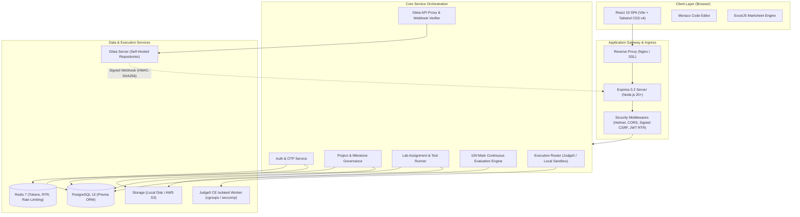
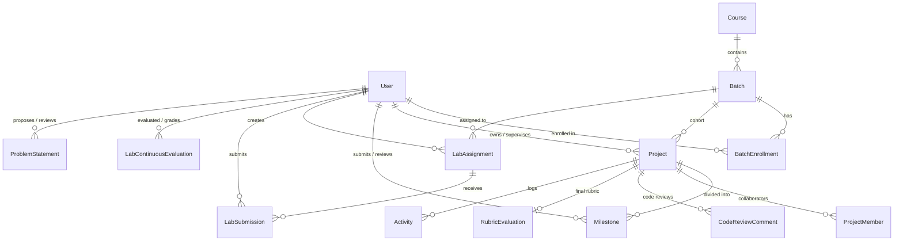

# GiteaForge LMS — System Architecture & Technical Specifications

This document provides a comprehensive technical overview of the **GiteaForge LMS** architecture, component interactions, threat model, security controls, and design principles.

---

## 1. System Vision & Domain Model

GiteaForge LMS is an institutional Learning Management System (LMS) specifically designed for university computer science and engineering departments. It bridges the gap between academic project oversight, version control integrity, and continuous practical laboratory examination.

### The Three Core Pillars

1. **Sovereign Git Infrastructure (Gitea)**: Replaces fragmented, unverified project submissions with self-hosted Git repositories where student commit streaks, branch creation, and code contributions are captured autonomously via real-time webhooks.
2. **Online Sandboxed Code Execution (Judge0 CE)**: Eliminates the "it worked on my machine" dispute by providing a browser-based Monaco editor and kernel-isolated container execution for multi-language labs and coding challenges.
3. **Statutory University Continuous Evaluation (100 Marks)**: Fully automates the academic examination register (10 continuous experiments $\times$ 4 marks notebook & performance = 40, Internal Viva = 10, End Semester Lab Test = 30, End Semester Viva = 20), generating audit-ready Excel marksheets for the Controller of Examinations.

---

## 2. High-Level Architecture Topology

---

## 3. Data Flow & Lifecycles

### 3.1 Authentication & Dual-Token Rotation
1. **Login Request**: User submits credentials (`email` + `password`).
2. **Verification**: Password verified via bcrypt (cost factor 10 or 12).
3. **Token Issuance**:
   - Short-lived **Access Token** (15 minutes) issued in response payload.
   - Cryptographically random **Refresh Token** (7 days) saved in Redis and emitted as an `httpOnly`, `SameSite`, `secure` cookie.
   - Cryptographically signed **CSRF Token** (HMAC-SHA256) emitted as cookie and header.
4. **Token Refresh**: Client uses refresh token cookie to call `/api/v1/auth/refresh-token`. Server issues a fresh access token and rotates the refresh token (RTR), revoking the previous one in Redis.

### 3.2 Capstone Git Repository & Push Webhook Flow
1. **Project Approval**: When a project is created or approved, the server calls Gitea's REST API (`/api/v1/orgs/:org/repos`) to provision a private repository.
2. **Student Pushes Code**: Student executes `git push origin main` to the self-hosted Gitea server.
3. **Webhook Trigger**: Gitea transmits a signed HTTP `POST` to `/api/v1/webhooks/gitea` with header `X-Gitea-Signature: sha256=<hmac>`.
4. **Signature Verification**: Express verifies the signature using `crypto.timingSafeEqual`.
5. **Telemetry & Milestone Auto-Update**: System logs push activity and updates the project's commit count and milestone readiness.

### 3.3 Lab Code Execution & Autograding
1. **Interactive Run**: Student enters code in the in-browser sandbox and clicks "Run Tests".
2. **Public Test Evaluation**: Backend routes code and public test cases to Judge0 CE (`POST /submissions?wait=true`).
3. **Container Sandboxing**: Judge0 Worker executes code in an isolated container with CPU and memory limits.
4. **Official Submission**: When submitted, code is tested against both public and hidden test cases. Scores, memory usage, and execution time are saved to `LabSubmission`.

---

## 4. Entity-Relationship Model (Prisma ORM)

---

## 5. Security & Threat Modeling

| Threat Surface | Potential Vulnerability | Implemented Defense & Verification |
|---|---|---|
| **Cross-Site Request Forgery (CSRF)** | Malicious third-party site triggers state-changing actions using browser cookies. | Double-submit signed CSRF token with HMAC-SHA256 signature and timestamp validation in `app.ts`. |
| **Token Theft & Replay** | Stolen refresh token used to sustain unauthorized access. | Single-use Refresh Token Rotation (RTR) backed by Redis revocation lists. Revokes entire session family if reuse is detected. |
| **Arbitrary Code Execution on Host** | Untrusted student code executes malicious binaries or accesses host filesystem. | Code execution delegated to containerized Judge0 CE with kernel cgroups, seccomp filters, and non-root isolation. |
| **Directory Traversal in Uploads** | Attacker crafts `../../etc/passwd` filename in multipart upload. | Filenames stripped via `path.basename()`, randomized with UUIDs on disk, and file content validated against magic-byte signatures. |
| **Broken Object-Level Auth (BOLA/IDOR)** | Student accesses another student's submission or private project repository. | Ownership verification (`checkProjectAccess`), batch cohort scoping, and stripping hidden test cases from student responses. |
| **Server-Side Request Forgery (SSRF)** | Admin config points Gitea URL to internal cloud metadata (e.g. `169.254.169.254`). | DNS resolution and IP address filter blocking loopback, link-local, and RFC1918 private subnets. |
| **CSV Formula Injection** | Malicious formula (`=cmd|' /C ...'!A1`) exported into supervisor Excel sheet. | Client-side and server-side cell sanitizer `sanitizeCsvCell` prefixes dangerous control characters (`=`, `+`, `-`, `@`, `\t`, `\r`) with single quotes. |

---

## 6. Regulatory & Accreditation Alignment

GiteaForge LMS is designed to satisfy statutory documentation standards for higher education regulatory bodies (such as **NAAC**, **NBA**, **ABET**, and national examination boards):
- **Criterion II: Teaching-Learning & Evaluation**: Verifiable continuous internal assessment registers with tamper-evident audit trails.
- **Criterion III: Research, Innovations & Extension**: Problem Statement Bank tracking industry-sponsored capstone themes and student intellectual property provenance.
- **Defensible Grading**: Complete historical commit logs and deliverable versioning to resolve student grading appeals objectively.

