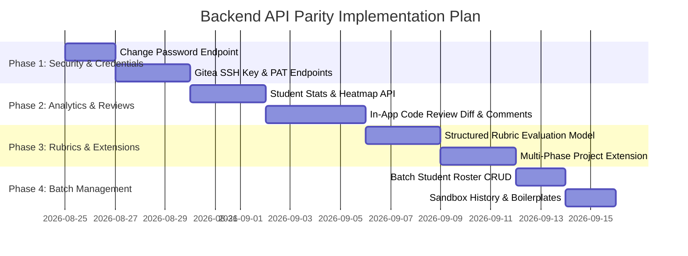

# GiteaForge LMS: Full-Stack API Gap Analysis & Route Specification

> **Document Purpose**: Comprehensive architectural analysis comparing the **Modern UI (`frontend/`)** with the **Express/Prisma Backend API (`server/`)**. This document catalogues all existing backend endpoints, details all missing routes required by the UI, specifies their exact request/response payloads, and provides the necessary Prisma schema enhancements.

---

## 📑 Table of Contents
1. [Executive Summary & Readiness Overview](#1-executive-summary--readiness-overview)
2. [Inventory of Existing Backend Routes](#2-inventory-of-existing-backend-routes)
3. [Comprehensive Gap Analysis: Missing Backend Routes](#3-comprehensive-gap-analysis-missing-backend-routes)
   - [3.1 User Profile, Security & Git Credentials](#31-user-profile-security--git-credentials)
   - [3.2 Student Analytics & Commit Velocity Heatmap](#32-student-analytics--commit-velocity-heatmap)
   - [3.3 In-App Code Review & Commit Diffs](#33-in-app-code-review--commit-diffs)
   - [3.4 Threaded Feedback & Resolution Engine](#34-threaded-feedback--resolution-engine)
   - [3.5 Milestone Lifecycle & Metadata Editing](#35-milestone-lifecycle--metadata-editing)
   - [3.6 Multi-Phase Project Extension Engine](#36-multi-phase-project-extension-engine)
   - [3.7 Structured Rubric Grading & Evaluation](#37-structured-rubric-grading--evaluation)
   - [3.8 Batch Student Roster Management](#38-batch-student-roster-management)
   - [3.9 Remote Sandbox Execution History & Boilerplates](#39-remote-sandbox-execution-history--boilerplates)
4. [Prisma Database Schema Enhancements](#4-prisma-database-schema-enhancements)
5. [Implementation Roadmap](#5-implementation-roadmap)

---

## 1. Executive Summary & Readiness Overview

```
┌───────────────────────────────────────────────────────────────────────┐
│                      API READINESS SCORE: 76%                        │
├───────────────────────────────────────────────────────────────────────┤
│  ✓ Core Authentication, Registration & Email Verification:    100%    │
│  ✓ Basic Project Creation, Listing & CRUD:                    90%     │
│  ✓ Milestone Submissions & AWS S3 Presigned URLs:             90%     │
│  ✓ Basic Gitea Integration (Repos, Commits, Branches):        80%     │
│  ✓ Judge0 Remote Code Execution:                              85%     │
│  ✓ Courses & Batches Base CRUD:                               85%     │
│  ✓ Admin User Governance, Import & Audit Logs:                90%     │
│  ✗ In-App Code Review & Inline Diff Commenting:               0%      │
│  ✗ SSH Key & Personal Access Token (PAT) Self-Service:        0%      │
│  ✗ Student Git Velocity Heatmap & Streak Aggregation:         0%      │
│  ✗ Nested Feedback Threads & Status Resolution:               15%     │
│  ✗ Multi-Phase Project Cloning & Extension:                   10%     │
└───────────────────────────────────────────────────────────────────────┘
```

The backend currently provides robust foundational support for authentication, project data, milestone file handling, and administrative controls. To achieve 100% full-stack parity with the new UI without relying on local mock fallbacks, the endpoints specified in Section 3 must be implemented.

---

## 2. Inventory of Existing Backend Routes

The backend router mounts the following 13 route modules under `/api/v1`:

### 2.1 Authentication Router (`/api/v1/auth`) — `authRoutes.ts`
- `POST /register` — Register student/supervisor with password hash & batch selection
- `POST /verify-email` — Verify 6-digit OTP code
- `POST /login` — Authenticate and issue JWT access token + refresh cookie
- `POST /refresh-token` — Exchange refresh token for new access token
- `POST /forgot-password` — Send reset password OTP/link
- `PATCH /reset-password` — Reset password using token
- `POST /logout` — Invalidate session and clear auth cookies

### 2.2 Users Router (`/api/v1/users`) — `userRoutes.ts`
- `GET /me` — Fetch current user profile with batch and active project count
- `PATCH /updateMe` — Update full name, phone number, and department
- `GET /supervisors` — List all supervisor accounts
- `GET /getAllUsers` — *(Admin)* List all platform users
- `GET /:id` — *(Admin)* Get specific user details

### 2.3 Projects Router (`/api/v1/projects`) — `projectRoutes.ts`
- `POST /create` — *(Student)* Create a capstone project and initialize Gitea repo
- `GET /me` — *(Student)* List all projects owned or co-authored by the user
- `GET /supervised` — *(Supervisor/Admin)* List projects assigned to supervisor
- `GET /:id` — Get project details, team members, and calculated milestone progress
- `PATCH /:id` — *(Student)* Update project title, description, and tech stack
- `DELETE /:id` — Delete project and cascade deliverables
- `POST /:id/submit-final` — *(Student)* Final capstone submission for defense
- `GET /:id/files` — List files in the project's linked Gitea repository
- `GET /:id/feedback` — Get feedback activity items for the project
- `POST /:id/feedback` — Post top-level feedback activity message
- `GET /:id/potential-members` — List peers from same batch available for team invitation
- `POST /:id/members` — Add student to project team
- `DELETE /:id/members/:userId` — Remove student from project team

### 2.4 Milestones Router (`/api/v1`) — `milestoneRoutes.ts`
- `POST /projects/:projectId/milestones` — *(Student)* Create a milestone deliverable
- `GET /projects/:projectId/milestones` — List all milestones for a project
- `PATCH /milestones/:id/start` — *(Student)* Transition milestone status to `IN_PROGRESS`
- `PATCH /milestones/:id/submit` — *(Student)* Upload attachments (multipart/form-data) to S3 and submit
- `PATCH /milestones/:id/approve` — *(Supervisor/Admin)* Approve deliverable
- `PATCH /milestones/:id/reject` — *(Supervisor/Admin)* Reject deliverable with remarks
- `GET /me/submissions` — *(Student)* List all submitted deliverables with S3 keys

### 2.5 Supervisors Router (`/api/v1/supervisors`) — `supervisorRoutes.ts`
- `GET /dashboard` — Supervisor dashboard metrics (supervised count, pending reviews)
- `GET /projects` — List assigned projects
- `GET /milestones/pending` — List deliverables awaiting review
- `PATCH /milestones/:id/review` — Review and set grade remarks
- `GET /activity` — Supervisor-specific activity feed
- `GET /grades` — Evaluation summary across all supervised projects
- `PATCH /projects/:id/grade` — Assign final score (/100) and grade letter
- `POST /projects/:id/feedback` — Post evaluation feedback

### 2.6 Courses & Batches Routers (`/api/v1/courses`, `/api/v1/batches`)
- `GET /courses/allcourses` — *(Admin)* List all degree courses
- `POST /courses/create` — *(Admin)* Create a degree course
- `PATCH /courses/:id` — *(Admin)* Update course metadata
- `DELETE /courses/:id` — *(Admin)* Delete course
- `GET /batches/courses` — *(Public)* List active courses for registration dropdown
- `GET /batches/courses/:courseId/batches` — *(Public)* List batches for a course
- `GET /batches` — *(Admin)* List all batches with student enrollment counts
- `POST /batches` — *(Admin)* Create a new batch
- `DELETE /batches/:id` — *(Admin)* Delete a batch

### 2.7 Admin Router (`/api/v1/admin`) — `adminRoutes.ts`
- `GET /stats` — Total students, supervisors, active projects, pass rate
- `GET /projects` — Global project list with supervisor assignment status
- `GET /projects/export` — Rich dataset for Excel/CSV project updates
- `PATCH /projects/:id/assign-supervisor` — Assign faculty supervisor to a project
- `GET /audit-logs` — System-wide security & activity audit stream
- `DELETE /users/:id` — Delete user account
- `PATCH /users/:id` — Edit user name, role, department, university ID
- `POST /users/import-csv` — Bulk create student accounts via CSV
- `GET /gitea/config` & `POST /gitea/config` — Manage Gitea server connection settings
- `POST /gitea/test` — Test Gitea server connectivity, token validity & latency

### 2.8 Remote Execution & Utilities
- `POST /api/v1/execute` — Execute code via Judge0 CE (Python, JS, TS, Java, C++, Rust, Go)
- `GET /api/v1/execute/languages` — Get supported compiler runtime versions
- `GET /api/v1/uploads/presigned/*key` — Generate authenticated S3 download URL
- `POST /api/v1/webhooks` — Gitea push webhook handler with HMAC-SHA256 verification
- `GET /api/v1/activities/me` & `/project/:projectId` — Activity stream logs

---

## 3. Comprehensive Gap Analysis: Missing Backend Routes

The following endpoints are required to fully support all views and interactive components in the New UI:

---

### 3.1 User Profile, Security & Git Credentials
**UI Location**: `Profile Screen -> Security Tab (Option B)`

#### `PATCH /api/v1/users/change-password`
* **Access**: Authenticated (`STUDENT`, `SUPERVISOR`, `ADMIN`)
* **Purpose**: Allows a logged-in user to change their password securely.
* **Request Body**:
  ```json
  {
    "currentPassword": "OldPassword123!",
    "newPassword": "NewSecurePassword456!"
  }
  ```
* **Response `200 OK`**:
  ```json
  {
    "status": "success",
    "message": "Password updated successfully"
  }
  ```

#### `GET /api/v1/users/me/ssh-keys`
* **Access**: Authenticated (`STUDENT`, `SUPERVISOR`)
* **Purpose**: Retrieves the list of public SSH keys registered in Gitea for the user.
* **Response `200 OK`**:
  ```json
  {
    "status": "success",
    "data": [
      {
        "id": 12,
        "title": "MacBook Pro - ED25519",
        "fingerprint": "SHA256:7uK+zM98n4...",
        "keyType": "ssh-ed25519",
        "createdAt": "2026-02-14T08:30:00Z"
      }
    ]
  }
  ```

#### `POST /api/v1/users/me/ssh-keys`
* **Access**: Authenticated (`STUDENT`, `SUPERVISOR`)
* **Purpose**: Registers a new SSH public key in Gitea for Git terminal pushes.
* **Request Body**:
  ```json
  {
    "title": "Laptop Terminal",
    "key": "ssh-ed25519 AAAAC3NzaC1lZDI1NTE5AAAAI... user@machine"
  }
  ```

#### `DELETE /api/v1/users/me/ssh-keys/:keyId`
* **Access**: Authenticated (`STUDENT`, `SUPERVISOR`)
* **Purpose**: Deletes an SSH key from the user's Gitea profile.

#### `POST /api/v1/users/me/gitea-token/regenerate`
* **Access**: Authenticated (`STUDENT`)
* **Purpose**: Regenerates a Personal Access Token (PAT) with repository read/write scopes.
* **Response `200 OK`**:
  ```json
  {
    "status": "success",
    "data": {
      "token": "gto_9a8f7e6d5c4b3a210fedcba...",
      "createdAt": "2026-08-23T18:00:00Z"
    }
  }
  ```

---

### 3.2 Student Analytics & Commit Velocity Heatmap
**UI Location**: `Student Dashboard -> Overview & Stats Grid`

#### `GET /api/v1/users/me/stats`
* **Access**: Authenticated (`STUDENT`)
* **Purpose**: Aggregates personal performance metrics for the `STUDENT Stats` card.
* **Response `200 OK`**:
  ```json
  {
    "status": "success",
    "data": {
      "totalProjects": 3,
      "totalCommits": 127,
      "milestoneProgress": 75,
      "overallGrade": "A",
      "approvedDeliverables": 8,
      "pendingReviews": 1
    }
  }
  ```

#### `GET /api/v1/activities/heatmap`
* **Access**: Authenticated (`STUDENT`)
* **Purpose**: Computes a 12-week day-by-day commit intensity matrix for the dashboard heatmap.
* **Response `200 OK`**:
  ```json
  {
    "status": "success",
    "data": {
      "currentStreak": 5,
      "longestStreak": 14,
      "totalCommits": 127,
      "weeks": [
        {
          "weekIndex": 1,
          "days": [
            { "date": "2026-06-01", "count": 3, "level": 2 },
            { "date": "2026-06-02", "count": 0, "level": 0 }
          ]
        }
      ]
    }
  }
  ```

---

### 3.3 In-App Code Review & Commit Diffs
**UI Location**: `Project Detail -> Sub-tab: Code Review`

#### `GET /api/v1/gitea/repos/:owner/:repo/commits/:sha/diff`
* **Access**: Authenticated (Project Members, Supervisor, Admin)
* **Purpose**: Returns unified and side-by-side patch chunks for an individual commit.
* **Response `200 OK`**:
  ```json
  {
    "status": "success",
    "data": {
      "commitSha": "0e57a8",
      "filesChanged": [
        {
          "filename": "src/server.ts",
          "additions": 14,
          "deletions": 2,
          "chunks": [
            {
              "oldStart": 1,
              "newStart": 1,
              "lines": [
                { "type": "ctx", "oldLine": 1, "newLine": 1, "content": "import express from 'express';" },
                { "type": "del", "oldLine": 2, "newLine": -1, "content": "const student = req.user.oldId;" },
                { "type": "add", "oldLine": -1, "newLine": 2, "content": "const student = req.user.id;" }
              ]
            }
          ]
        }
      ]
    }
  }
  ```

#### `GET /api/v1/projects/:id/code-review/comments`
* **Access**: Authenticated (Project Members, Supervisor, Admin)
* **Purpose**: Retrieves all inline line-by-line review comments left by supervisors.

#### `POST /api/v1/projects/:id/code-review/comments`
* **Access**: Authenticated (`SUPERVISOR`, `ADMIN`)
* **Purpose**: Saves a review comment attached to a specific line in a commit diff.
* **Request Body**:
  ```json
  {
    "commitSha": "0e57a8",
    "filePath": "src/server.ts",
    "lineNumber": 14,
    "side": "RIGHT",
    "content": "Ensure this change checks user enrollment before granting project access."
  }
  ```

---

### 3.4 Threaded Feedback & Resolution Engine
**UI Location**: `Project Detail -> Sub-tab: Feedback Threads`

#### `POST /api/v1/projects/:id/feedback/:feedbackId/reply`
* **Access**: Authenticated (Project Members, Supervisor, Admin)
* **Purpose**: Adds a nested reply to an existing feedback thread item.
* **Request Body**:
  ```json
  {
    "content": "We have refactored the auth middleware as suggested."
  }
  ```

#### `PATCH /api/v1/projects/:id/feedback/:feedbackId/resolve`
* **Access**: Authenticated (Supervisor, Project Owner)
* **Purpose**: Marks a feedback discussion item as resolved or reopens it.
* **Request Body**:
  ```json
  {
    "resolved": true
  }
  ```

---

### 3.5 Milestone Lifecycle & Metadata Editing
**UI Location**: `Project Detail -> Milestones & Submissions`

#### `PATCH /api/v1/milestones/:id`
* **Access**: Authenticated (`STUDENT` - owner)
* **Purpose**: Updates milestone title, description, or due date prior to submission.
* **Request Body**:
  ```json
  {
    "title": "System Architecture & API Specs (v2)",
    "description": "Updated database schema and route diagrams",
    "dueDate": "2026-09-15T23:59:59Z"
  }
  ```

#### `DELETE /api/v1/milestones/:id`
* **Access**: Authenticated (`STUDENT` - owner, `ADMIN`)
* **Purpose**: Deletes an unsubmitted milestone deliverable.

---

### 3.6 Multi-Phase Project Extension Engine
**UI Location**: `Create Project Modal -> Wizard Step 1: Extend Option`

#### `POST /api/v1/projects/:id/extend`
* **Access**: Authenticated (`STUDENT`)
* **Purpose**: Clones an approved Phase 1 project into Phase 2, linking `parentProjectId`, carrying forward team members, and establishing phase milestone structures.
* **Request Body**:
  ```json
  {
    "title": "Distributed LMS (Phase 2 - Microservices)",
    "description": "Extending core LMS with Kafka event streaming and Kubernetes cluster deployment",
    "technologies": ["TypeScript", "Docker", "Kafka", "Kubernetes"],
    "newBatchId": "b1"
  }
  ```

---

### 3.7 Structured Rubric Grading & Evaluation
**UI Location**: `Supervisor -> Capstone Project Evaluation & Grades`

#### `GET /api/v1/projects/:id/rubric`
* **Access**: Authenticated (Supervisor, Project Owner, Admin)
* **Purpose**: Returns the structured rubric evaluation breakdown for defense reports.
* **Response `200 OK`**:
  ```json
  {
    "status": "success",
    "data": {
      "projectId": "p1",
      "grade": "A+",
      "totalScore": 94,
      "breakdown": {
        "codeQuality": 95,
        "milestonesComplete": 100,
        "documentation": 90,
        "presentation": 92,
        "teamwork": 95
      },
      "feedback": "Outstanding architecture with thorough unit and integration test coverage.",
      "gradedBy": "Dr. Sarah Jenkins",
      "gradedAt": "2026-08-20T14:30:00Z"
    }
  }
  ```

---

### 3.8 Batch Student Roster Management
**UI Location**: `Admin Dashboard -> Batches & Academic Courses`

#### `GET /api/v1/batches/:id/students`
* **Access**: Authenticated (`ADMIN`)
* **Purpose**: Lists all students currently enrolled in a specific batch.

#### `POST /api/v1/batches/:id/students`
* **Access**: Authenticated (`ADMIN`)
* **Purpose**: Enrolls an individual student into a batch by User ID.
* **Request Body**:
  ```json
  {
    "userId": "usr_9012"
  }
  ```

#### `DELETE /api/v1/batches/:id/students/:userId`
* **Access**: Authenticated (`ADMIN`)
* **Purpose**: Removes a student enrollment from a batch.

---

### 3.9 Remote Sandbox Execution History & Boilerplates
**UI Location**: `Code Sandbox Screen`

#### `GET /api/v1/execute/history`
* **Access**: Authenticated
* **Purpose**: Returns the user's past 10 code execution runs with telemetry (runtime ms, memory usage, exit code).

#### `GET /api/v1/execute/templates/:language`
* **Access**: Authenticated
* **Purpose**: Fetches standard algorithm starter boilerplates (e.g. Graph BFS, Binary Search Tree, REST Server) for preloading in the IDE.

---

## 4. Prisma Database Schema Enhancements

To support the missing features, the following Prisma schema extensions are recommended:

```prisma
// ─── 1. Inline Code Review Comments ───────────────────────────────────────────
model CodeReviewComment {
  id          String   @id @default(cuid())
  projectId   String
  commitSha   String
  filePath    String
  lineNumber  Int
  side        String   @default("RIGHT") // LEFT (old) | RIGHT (new)
  content     String
  authorId    String
  isResolved  Boolean  @default(false)
  createdAt   DateTime @default(now())
  updatedAt   DateTime @updatedAt

  project     Project  @relation(fields: [projectId], references: [id], onDelete: Cascade)
  author      User     @relation(fields: [authorId], references: [id], onDelete: Cascade)

  @@index([projectId, commitSha])
  @@map("code_review_comments")
}

// ─── 2. Structured Rubric Evaluation ───────────────────────────────────────────
model RubricEvaluation {
  id              String   @id @default(cuid())
  projectId       String   @unique
  totalScore      Float
  letterGrade     String   // "A+", "A", "B+", "B", "C", "F"
  codeQuality     Float    @default(0)
  documentation   Float    @default(0)
  presentation    Float    @default(0)
  innovation      Float    @default(0)
  teamwork        Float    @default(0)
  feedback        String?
  evaluatorId     String
  createdAt       DateTime @default(now())
  updatedAt       DateTime @updatedAt

  project         Project  @relation(fields: [projectId], references: [id], onDelete: Cascade)
  evaluator       User     @relation(fields: [evaluatorId], references: [id])

  @@map("rubric_evaluations")
}

// ─── 3. Threaded Project Feedback ─────────────────────────────────────────────
model ProjectFeedback {
  id          String            @id @default(cuid())
  projectId   String
  authorId    String
  parentId    String?           // For nested replies
  content     String
  isResolved  Boolean           @default(false)
  createdAt   DateTime          @default(now())
  updatedAt   DateTime          @updatedAt

  project     Project           @relation(fields: [projectId], references: [id], onDelete: Cascade)
  author      User              @relation(fields: [authorId], references: [id], onDelete: Cascade)
  parent      ProjectFeedback?  @relation("ThreadReplies", fields: [parentId], references: [id], onDelete: Cascade)
  replies     ProjectFeedback[] @relation("ThreadReplies")

  @@index([projectId])
  @@map("project_feedbacks")
}
```

---

## 5. Implementation Roadmap


