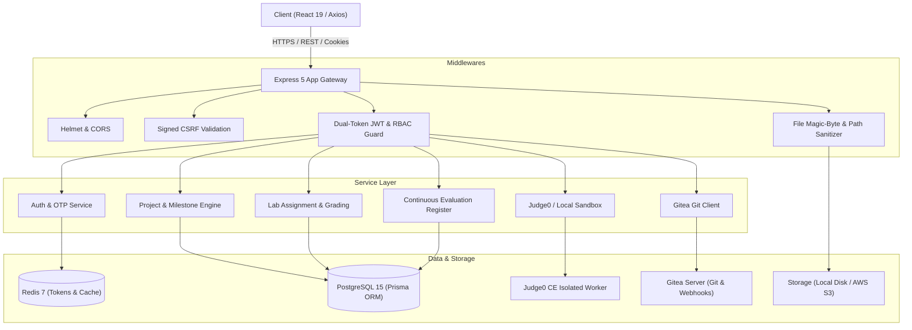

# GiteaForge LMS — Server Architecture & Engineering Guide

This document describes the backend architecture, directory structure, data layer, and developer workflows for the **GiteaForge LMS** server.

---

## 1. Architecture Overview

The backend is built with **Node.js (v20+)**, **Express v5.2**, and **TypeScript**, using **Prisma ORM (v7.7)** over **PostgreSQL 15**, and **Redis 7** for session tracking, token revocation, and rate-limit caching.



---

## 2. Directory Structure

```
server/
├── prisma/
│   ├── schema.prisma           # Prisma data models, relations, indexes & enums
│   ├── seed.ts                 # Full database seed script (universities, courses, batches)
│   ├── seedUsers.ts            # User accounts seed script
│   ├── seedGiteaUsers.ts       # Gitea account synchronization seed
│   └── seedGiteaRepos.ts       # Sample student repository generation seed
├── scripts/
│   ├── smoke-test.js           # Fast endpoint connectivity & health validation
│   ├── stress-test.js          # Autocannon concurrency & throughput benchmark
│   ├── lms-realistic-load-test.js # Simulated academic session load runner
│   └── run-k6.js               # k6 test orchestrator
├── uploads/                    # Local storage for student submissions & faculty manuals
├── src/
│   ├── index.ts                # Server startup, port binding, and graceful shutdown
│   ├── app.ts                  # Express application setup, security middleware, route mounting
│   ├── config/
│   │   ├── db.ts               # Prisma client instantiation with connection pooling
│   │   ├── env.ts              # Zod-validated environment variable schema
│   │   ├── gitea.ts            # Axios client configured for Gitea API
│   │   ├── redis.ts            # ioredis client configuration and connection handling
│   │   └── resend.ts           # Resend email client instantiation
│   ├── controllers/
│   │   ├── activityController.ts
│   │   ├── adminController.ts
│   │   ├── authController.ts
│   │   ├── batchController.ts
│   │   ├── courseController.ts
│   │   ├── courseEvaluationController.ts
│   │   ├── executeController.ts
│   │   ├── giteaController.ts
│   │   ├── labAssignmentController.ts
│   │   ├── milestoneController.ts
│   │   ├── problemStatementController.ts
│   │   ├── projectController.ts
│   │   ├── supervisorController.ts
│   │   └── userController.ts
│   ├── docs/
│   │   └── swagger.ts          # OpenAPI 3.0 / Swagger UI definition
│   ├── middlewares/
│   │   ├── authMiddleware.ts   # JWT authentication, verified email, & RBAC guards
│   │   ├── fileUploadMiddleware.ts # Multer config, UUID naming, magic-byte inspection
│   │   ├── globalErrorHandler.ts   # Standardized JSON error response handler
│   │   ├── notFound.ts         # 404 handler
│   │   ├── requestIdMiddleware.ts  # Correlation ID (X-Request-Id) generation
│   │   └── validate.ts         # Zod schema validation middleware
│   ├── routes/
│   │   ├── activityRoutes.ts   # User & project activity streams
│   │   ├── adminRoutes.ts      # User management, supervisor allocation, audit logs
│   │   ├── authRoutes.ts       # Login, register, OTP verification, tokens, password reset
│   │   ├── batchRoutes.ts      # Batches and student enrollment rosters
│   │   ├── courseEvaluationRoutes.ts # 100-mark Continuous Evaluation Register
│   │   ├── courseRoutes.ts     # Degree programs & curriculum management
│   │   ├── executeRoutes.ts    # Judge0 / sandbox code execution & templates
│   │   ├── giteaRoutes.ts      # Gitea repository, branch, and commit proxy
│   │   ├── labAssignmentRoutes.ts # Lab assignments, submissions, and autograding
│   │   ├── milestoneRoutes.ts  # Capstone milestone submissions, reviews, rubrics
│   │   ├── problemStatementRoutes.ts # Problem Statement Bank & vetting
│   │   ├── projectRoutes.ts    # Student capstone projects, collaborators, feedback
│   │   ├── supervisorRoutes.ts # Faculty workload, pending reviews, dashboards
│   │   ├── uploadRoutes.ts     # Secure file download, upload, and presigned S3 URLs
│   │   ├── userRoutes.ts       # Current user profile, supervisor directory
│   │   └── webhookRoutes.ts    # Gitea HMAC-SHA256 push event handler
│   ├── schemas/                # Zod schemas for request validation
│   ├── services/
│   │   ├── activityService.ts
│   │   ├── authService.ts
│   │   ├── giteaService.ts
│   │   ├── gradingService.ts   # Automated test runner & scoring logic
│   │   ├── judge0Service.ts    # Judge0 CE integration client
│   │   ├── localRunnerService.ts # Fallback host execution sandbox
│   │   └── sendVerificationEmail.ts # Nodemailer / Resend notification engine
│   ├── types/                  # TypeScript interface declarations
│   ├── utils/
│   │   ├── appError.ts         # Operational error classes
│   │   ├── catchAsync.ts       # Async error forwarding wrapper
│   │   ├── createSendToken.ts  # Dual-token JWT issuer & CSRF generator
│   │   └── requireObjectId.ts  # ID format assertion helpers
│   └── __tests__/              # Jest test suites
```

---

## 3. Database & Prisma Workflows

The server utilizes Prisma ORM with PostgreSQL. All models are defined in `prisma/schema.prisma`.

### Common Commands

```bash
# Generate Prisma Client after schema changes
npm run db:generate

# Create and apply a new migration in development
npm run db:migrate

# Apply migrations in production without prompting
npm run db:migrate:prod

# Inspect database visually via Prisma Studio (port 5555)
npm run db:studio

# Reset database (drops all tables and runs migrations)
npm run db:reset

# Seed complete demo data
npm run db:seed
```

### Key Relational Models

- **User**: Students, Faculty Supervisors, and Administrators. Unique email, university ID, and linked Gitea username.
- **Course & Batch**: Degree programs (e.g., B.Tech CSE) partitioned into academic cohorts (`BatchEnrollment`).
- **Project**: Student capstone with optional linked Gitea repository (`repoUrl`), assigned supervisor, phase progress, collaborators (`ProjectMember`), and rubric evaluations (`RubricEvaluation`).
- **Milestone**: Structured project phase with due dates, attachments, student notes, and supervisor review states (`PENDING`, `SUBMITTED`, `APPROVED`, `REJECTED`).
- **LabAssignment & LabSubmission**: Practical lab experiments with submission types (`CODING` vs `PDF_REPORT`), test cases (public and hidden), execution limits, and multi-attempt tracking.
- **LabContinuousEvaluation**: Statutory university 100-mark evaluation register capturing 10 continuous experiments (notebook + performance = 40), internal viva (10), end-sem lab test (30), and end-sem viva (20).

---

## 4. Security Hardening

1. **Authentication & Session Management**:
   - Access tokens (15m lifetime) sent via `Authorization: Bearer <token>`.
   - Refresh tokens (7d lifetime) issued as `httpOnly`, `SameSite`, `secure` cookies with Refresh Token Rotation (RTR) backed by Redis.
2. **Double-Submit CSRF Protection**:
   - Cryptographically signed CSRF cookie (`csrfToken`) verified on all mutating HTTP methods (`POST`, `PUT`, `PATCH`, `DELETE`).
   - HMAC-SHA256 signature verification prevents token spoofing.
3. **Webhook Verification**:
   - Gitea webhooks are verified with HMAC-SHA256 using `crypto.timingSafeEqual` to prevent timing attacks.
4. **File Upload Security**:
   - File extensions validated against strict allowlists.
   - Files renamed to UUIDs to prevent directory traversal or overwrites.
   - Magic bytes / MIME header inspection ensures file contents match declared types.
   - Files served with `X-Content-Type-Options: nosniff` and scoped Content Security Policies.
5. **SSRF Protection**:
   - Gitea configuration endpoints resolve hostnames and block private RFC1918, loopback, and link-local IP addresses.

---

## 5. Development & Testing

```bash
# Start development server with live reload (tsx)
npm run dev

# Check TypeScript types
npm run type-check

# Run unit and integration tests (Jest)
npm run test

# Run HTTP smoke test
npm run test:smoke

# Run Autocannon stress test
npm run test:stress

# Run realistic academic session load simulation
npm run test:realistic
```
